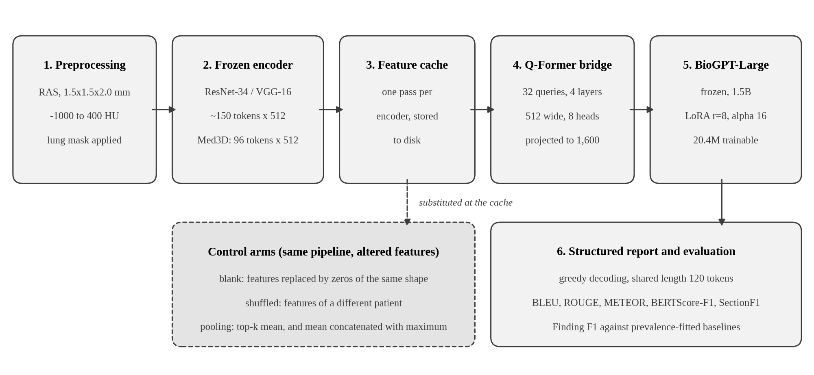
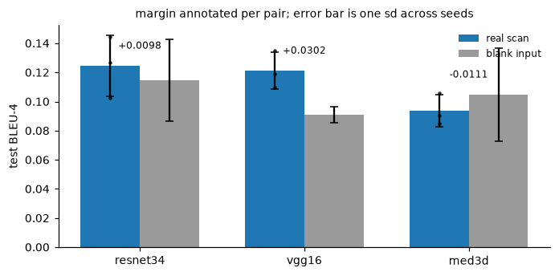
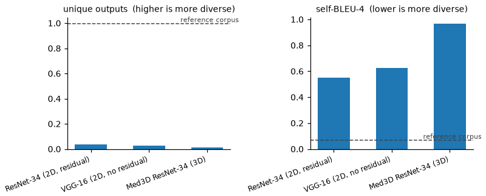
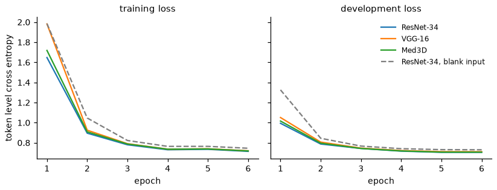

# Structured radiology report generation from 3D chest CT

MSc dissertation, University of Hull, 2026. Supervised by Dr Eva Sousa.
Full title: *Structured Radiology Report Summarisation from Chest CT Using RadGenome-ChestCT.*

I built a vision-language pipeline that takes a 3D chest CT scan and writes a structured, region-by-region radiology report. I then tested whether the model was actually reading the scan. It was not: a version trained on blank images scored in the same range (0.09 to 0.12 BLEU-4) as every real image encoder, so the scores were coming from the language model, not from the CT. This repository contains the full study, including the controls that exposed it.



## Why this matters

A report generator can produce fluent, plausible text and still ignore the image. Text-overlap metrics such as BLEU and ROUGE will not catch that on their own, because they reward the typical wording of chest CT reports. Any AI that claims to read a medical image needs a control that removes the image and checks whether performance falls. This project is a worked example of that check, and the same principle applies to validating any AI-based diagnostic before it reaches a patient.

## What I built

1. **Preprocessing (MONAI):** reorientation to RAS, resampling to 1.5 x 1.5 x 2.0 mm, a Hounsfield unit window of -1000 to 400, and a lung mask so every non-lung voxel is zero.
2. **Frozen image encoder, three arms:** ResNet-34 and VGG-16 applied slice by slice (2D), and Med3D, a 3D ResNet-34 pretrained on medical volumes.
3. **Feature cache:** each encoder runs once and its features are stored, so comparing encoders costs one extraction pass, not a full retrain.
4. **Q-Former-style bridge:** 32 learned queries, 4 cross-attention layers and 8 heads, which convert image features into input the language model can use.
5. **BioGPT-Large (1.5 billion parameters) with low-rank adaptation (LoRA):** rank 8, alpha 16, on the attention query and value projections. 20.4 million trainable parameters out of 1,592 million.
6. **Evaluation:** BLEU-1 to BLEU-4, ROUGE, METEOR, BERTScore and a finding-level F1 across 14 clinical findings, with negation handled at clause level.

**Data:** 1,341 chest CT volumes from RadGenome-ChestCT, split at patient level so no patient appears in two sets: 789 training, 143 development and 409 test.
**Compute:** NVIDIA A100 (40 GB partition) on the University of Hull Viper HPC cluster, scheduled with Slurm. Three seeds per arm (42, 7 and 2024).

## Controls

- **Blank input:** the same pipeline, with the image features replaced by zeros. If the scan matters, this arm should score clearly lower.
- **Shuffled input:** each report paired with a different patient's scan.
- **Statistics:** three seeds per arm and 500 paired bootstrap resamples of the 409 test studies, so real differences can be separated from training noise.

## Results

Mean test BLEU-4 across three seeds, plus or minus one standard deviation:

| Encoder | Real scan | Blank input |
|---|---|---|
| ResNet-34 (2D) | 0.1245 ± 0.0210 | 0.1147 ± 0.0283 |
| VGG-16 (2D) | 0.1211 ± 0.0128 | 0.0909 ± 0.0055 |
| Med3D (3D) | 0.0936 ± 0.0109 | 0.1047 ± 0.0319 |



What the evidence shows:

- Every arm scored between 0.09 and 0.12 BLEU-4, and the model trained on blank input scored in the same range. Most of the score reflects the language model learning how chest CT reports are usually written.
- VGG-16 was the only encoder to beat its own blank control by more than two standard deviations. Even so, its finding-level F1 (0.27) stayed below a simple baseline that predicts findings from their frequency in the training set (0.36).
- Med3D, set up this way, scored slightly below its own blank control.
- The generated reports were highly repetitive: under 4% of outputs were unique for every encoder, which is consistent with the model defaulting to a typical report.



**Interpretation.** The bottleneck sits upstream of report generation: frozen encoders that were never trained on lung pathology, and 789 training studies. A language model cannot describe what the encoder never encoded. The next step is fine-tuning the encoder, or starting from a CT-native encoder, and repeating the same blank-input control.

**Limitation.** I did not cross-validate. Training BioGPT-Large on a shared GPU is expensive, so I used three seeds and a paired bootstrap instead. Because the blank arm varies across seeds as much as the real arms do, cross-validation would not change the central finding.



## Repository contents

| Path | Contents |
|---|---|
| `chest_ct_report_generation.ipynb` | The full study, from cohort construction to the final audit of every reported number. Outputs are cleared, because several cells display CT slices and report text from a gated dataset. |
| `config.py`, `src/` | Data download, environment checks, report exploration and volume inspection |
| `figures/` | Pipeline diagram, real against blank results, output diversity, training curves |

## Running it

A Linux machine with a CUDA GPU is required. The bitsandbytes library and the training cells will not run on Apple silicon.

```bash
pip install -r requirements.txt
# then install the PyTorch build that matches your CUDA version
```

RadGenome-ChestCT and CT-RATE are gated on Hugging Face. Request access on both dataset pages, then run `huggingface-cli login`. No data from either dataset is stored in this repository.

## What I learned

- Run a blank-input control before trusting any generation metric. It was the cheapest experiment in the project and it changed the conclusion.
- Freezing the encoder and caching features makes encoder comparisons affordable, but a frozen encoder cannot learn features it never had.
- Use one decoding length for every arm. Tuning it per arm lets the BLEU brevity penalty choose the winner.
- Keep a claim sheet. Every number in the write-up traces back to the notebook cell that produced it.

## Data and credit

- RadGenome-ChestCT: Zhang et al., *Scientific Data*, 2025. Built on CT-RATE: Hamamci et al., *Nature Biomedical Engineering*, 2026.
- BioGPT (Luo et al., 2022), LoRA (Hu et al., 2021), BLIP-2 Q-Former (Li et al., 2023), Med3D (Chen et al., 2019), MONAI.

Clovers Akitoye · [GitHub](https://github.com/maryclovers) · [LinkedIn](https://www.linkedin.com/in/cloversakitoye)
